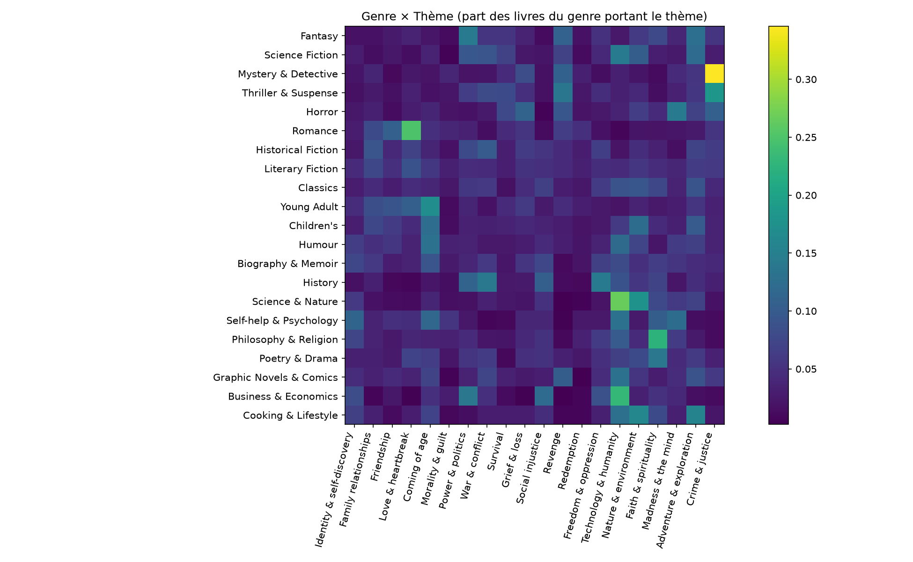

# 3. Block taxonomy and semantic enrichment (P2)

The assignment suggests describing each book by a genre, themes, a style and keywords. The Book Depository dataset provides none of this: it only contains free-text descriptions and more than a thousand very noisy commercial categories ("Fiction", "Teaching Resources & Education"…). Rather than annotating 12,000 books by hand, we **derived this information through semantic analysis**, which is consistent with the goal of the project. Everything is reproduced with a single command (`python -m scripts.run_enrichment`) that directly produces the final `books_enriched.parquet` file.

**Taxonomy.** We built `blocks.json`, a taxonomy in four blocks: Genre (21 labels), Themes (20), Style (10) and Atmosphere (15, including 6 periods and 9 moods). Each label comes with a **descriptive sentence in natural language** ("A story about grief, death, mourning, loss and learning to live with absence"). It is this sentence that is encoded, not the bare word: a blurb about a "young boy who discovers he is a wizard" thus gets close to *Fantasy* and *Coming of age* without any of these words appearing. The taxonomy is inspired by the main families of publishing (bookshop sections, BISAC) and by classic themes of literary analysis.

**Genres.** The 1,074 Book Depository categories are mapped to our genres in two steps: regular-expression rules for the obvious cases ("Fantasy Books" → Fantasy, with exclusions such as "Romance Languages"), then, for the rest, the closest genre by cosine similarity between the embedding of the category name and that of the genre's sentence (accepted if cosine ≥ 0.30). We reviewed the 100 most frequent categories and corrected 18 of them by hand (for example *Adventure Books*, 710 books, wrongly classified as children's literature). A book inherits the genres of its categories, ranked by the number of agreeing categories and then by closeness to its description; the genre closest to the description also votes, which fixes misleading commercial categories (*Harry Potter* is filed under "Sci Fi" by Book Depository). **The "Young Adult" and "Children's" genres come only from the `audience` column**: a first version assigned them to more than 600 adult books through categories and embeddings, which was wrong.

**Themes, style, atmosphere.** These labels are assigned by *zero-shot* with embeddings: cosine between the book's description (SBERT `all-MiniLM-L6-v2`, normalised vectors) and each label sentence. This choice is fast (the whole catalogue in a few seconds on CPU), whereas an NLI zero-shot would require one model pass per book × label pair. Three choices make the result usable:

- a **per-label normalisation** (subtracting the label's mean over the catalogue, with a scale shared by the block), because some sentences are close to all books; one standard deviation per label instead inflated the less dispersed labels;
- a **calibrated threshold** (z ≥ 1.0) with at least one label guaranteed for themes and styles;
- for the **themes (v2)**, each theme is represented by the average of the embedding of its sentence and of three more concrete variants (`theme_variants.json`), because a single abstract sentence drifted away from the real vocabulary of the blurbs. These variants are built into the pipeline itself: rerunning the enrichment always reproduces v2.

**Atmosphere.** At least one value is always assigned (the best mood), but **the period of the story is never forced**: it is only kept if its score is high and clearly higher than that of the second best period. A first version imposed a period on every book and was often wrong (for example *Harry Potter* classified as "Medieval"). A book can therefore have one or two atmosphere values, and having no period is a valid result. All the cosines are kept in `label_scores`, which the scoring engine reuses.

**Keywords.** We apply the KeyBERT principle (candidate–document similarity followed by MMR diversification, 5 keywords per book). The candidates are **noun phrases only**: part-of-speech tagging (spaCy) keeps runs of adjectives + nouns, which rules out verb + noun pairs ("deals issues"); a blacklist removes publisher and layout vocabulary ("font size", "edition"), and the names of the book's authors are excluded. To run on CPU, the candidates are pre-ranked by TF-IDF (15 per book) before being reordered by embeddings.

**Validation.** We annotated 60 books (genres and themes). The initial proposal was produced by an LLM from the descriptions, without access to the model's predictions, then **reviewed and corrected by hand** by the author of the pipeline (Hajar, P2). These 60 books were, however, used to **choose the theme sentences and the threshold**: their scores are therefore optimistic. To measure the real performance, we separately annotated **40 books never used for tuning** (test set), drawn at random from the remaining books (30 fiction and 10 non-fiction). Only the test-set results measure the quality of the system. The confidence intervals are wide, because the set is small.

<!-- EVAL:START -->
| Set | Books | Genres: precision / recall / ≥1 correct label | Themes: precision / recall / ≥1 correct label |
|---|---|---|---|
| Tuning (60 books, seen during tuning) | 60 | 0.64 [0.58-0.71] / 0.78 [0.71-0.85] / 97% [92%-100%] | 0.51 [0.41-0.61] / 0.39 [0.31-0.46] / 72% [60%-83%] |
| **Test (never-seen books)** | 40 | 0.72 [0.63-0.80] / 0.64 [0.56-0.72] / 100% [100%-100%] | 0.50 [0.38-0.61] / 0.34 [0.25-0.43] / 68% [52%-80%] |

Values in brackets are 95% confidence intervals (bootstrap over the books).
The performance to retain is that of the test set: on 40 books never used for tuning, the themes reach an F1 of 0.40.
Annotations reviewed by: Hajar (initial proposal assisted by an LLM).
<!-- EVAL:END -->

Themes are harder than genres: a book can legitimately carry four themes while we only annotate two or three, and close themes (*Grief & loss*, *Family relationships*) get confused. Errors also come from uninformative marketing descriptions.

{width=90%}

**Limitations.** The tone bias of commercial descriptions, MiniLM's 256-token truncation, the subjectivity of themes (annotation by a single person, the author of the pipeline, without an agreement measure), the size of the test set, and the fact that the variant sentences were written by us and tuned on the tuning set. Next steps: a finer model (MPNet), NLI on ambiguous cases, targeted manual corrections.
