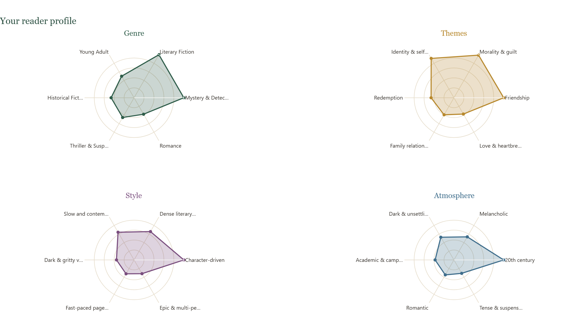
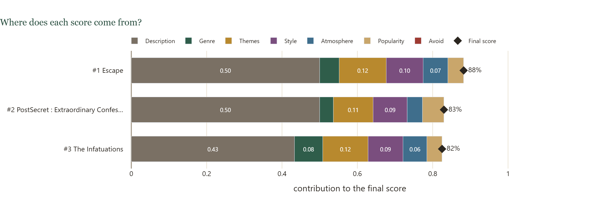
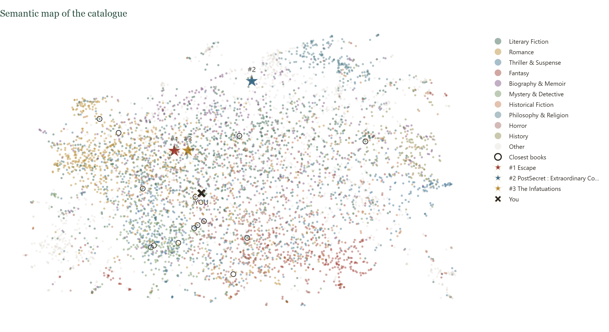

# 6. Web application and visualisations (P5)

The application, *GenderBook*, is built with **Streamlit** (`app/streamlit_app.py`) and is started with `streamlit run app/streamlit_app.py`. It runs in three stages: a questionnaire, a call to the recommendation engine (`recommend(answers, top_k=3)`, section 5) and a results page that shows **how** each score is obtained.

**Questionnaire.** The 17 questions are spread over five steps, with a progress bar and Back / Next navigation. They cover the five required question types: **free text** (four questions, one of them mandatory with at least 30 characters), **checkboxes** (genres and themes), **multiple choice** (era of the story, audience, formats), **Likert scales** from 1 to 5 with explicit labels at both ends (complexity, pace, tone, popularity, then the importance of each of the four blocks) and **guided questions** (the favourite author, asked only if the user has one, is looked up live in the catalogue). The labels are read from `blocks.json`, so the interface and the engine share the same label set, and each checkbox's tooltip shows the label's descriptive sentence. The chosen era is a label of the Atmosphere block (the era of the **story**), not a filter on the publication year. Each submission is saved as a timestamped JSON file in `data/responses/` and can be downloaded.

**Results page.** Each of the three recommendations shows the four required elements: the book (title and authors; no cover, as the dataset's image links are dead since Book Depository closed), its score (gauge, *Excellent / Good / Partial match* badge, coverage score), its main criteria (the shared labels with their similarity, coloured by block, and the score breakdown) and a template-based explanation. To show that the result comes from the semantic analysis, we display the **sentence of the synopsis closest** to the request, also highlighted in the synopsis, and a "How was this score computed?" panel that gives the formula and, for each component, the calibrated similarity, the weight and the contribution.

**Visualisations.** The figures come from pure Plotly functions in `src/viz.py`, with one colour per block. The **profile radar** shows, block by block, the labels closest to the answers: the user can check that the request was understood. The **"you vs the books" radar** overlays the importance given to each block and each book's score on it: it is the visual reading of the coverage score. The **stacked bars** break the final score down into contributions (synopsis, blocks, popularity, "avoid" penalty) that add up to the score. The **semantic map** shows the 12,000 books in 2D (UMAP on the SBERT embeddings, computed by P3): genres form coherent regions, the user is placed at the similarity-weighted average position of their fifteen closest books and the top 3 is highlighted. Finally, the **heatmap** crosses the user's sentences with the book's labels and its closest sentence: a dark cell links two different phrasings of the same idea, which illustrates the difference with keyword matching.

{width=90%}

{width=90%}

{width=90%}

**Robustness.** Heavy resources are loaded once (`st.cache_resource`) and can be pre-computed (`scripts/prepare_app.py`). If no book passes the filters, the app offers to relax them; if the engine cannot load, it shows the error instead of crashing. Three pre-filled personas, in a demo menu opened with `?demo=1`, secure the demonstration.
