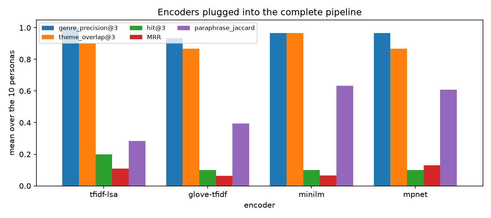
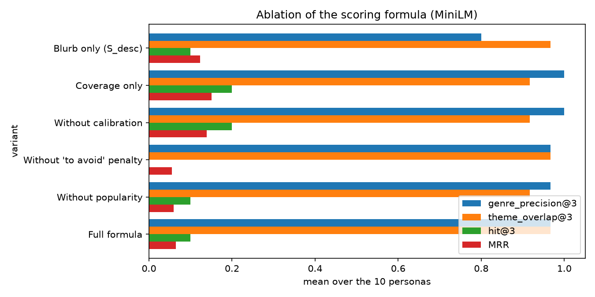
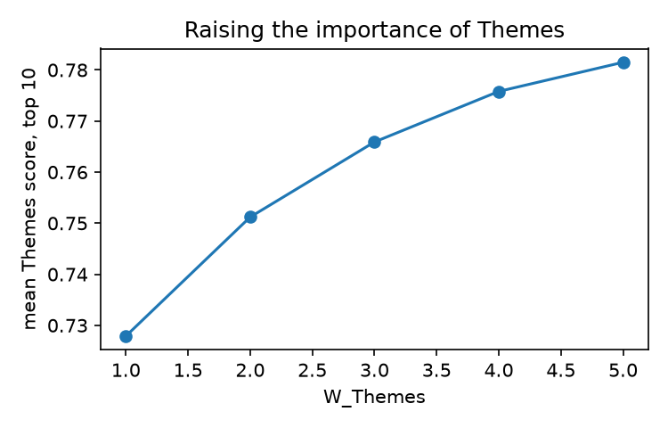

# 7. Evaluation

*Code: `notebooks/06_evaluation.ipynb`. Data: `data/eval/personas.json`.*

The previous sections evaluate each component separately: label quality (section 3, on 40 unseen books), the encoders on queries with no word in common (section 4), and the formula on the tuning personas (section 5). This section evaluates the **complete system** as the user sees it: starting from a filled-in questionnaire, is the top 3 relevant, stable and explainable?

## 7.1 Protocol

**Test set: 10 personas.** A persona is a fully filled-in questionnaire (`answers.json` format) together with the **expected answer**, fixed before running the system: the expected genres and themes, and 3 to 6 books from the catalogue judged relevant by hand. When the catalogue still contains several editions of the same work (*Middlemarch* has three), all of them are listed and any of them counts. Each persona also comes with three rephrasings of its main request (section 7.3).

The ten profiles cover deliberately varied requests and exercise every part of the pipeline:

| Persona | Audience | What it also tests |
|---|---|---|
| E01 Children's fantasy | Children | audience filter (only 1,318 books allowed) |
| E02 Nordic crime thriller | Adult | geographical atmosphere |
| E03 Historical romance | Adult | story period (18th–19th century) |
| E04 Young adult dystopia | Young Adult | format filter: two relevant books exist only in hardback and **must not appear** |
| E05 Literary psychological novel | Adult | complexity 5, slow pace |
| E06 Cosy mystery | Adult | light tone, "to avoid" text |
| E07 Memoir | Adult | non-fiction: the automatic fiction filter must stay off |
| E08 Supernatural horror | Adult | favourite author (Stephen King) **excluded** |
| E09 19th-century social novel | Adult | maximum weight on Style and Atmosphere |
| E10 Feel-good novel | Adult | preference for best-sellers |

Three precautions limit evaluator bias:
- the free texts **mention neither the titles nor the obvious keywords** of the expected books ("*a damaged hacker and a journalist dig into a powerful family's crimes*" rather than "*The Girl with the Dragon Tattoo*"): we measure understanding of meaning, not word lookup. This was checked automatically by searching the title words of each expected book in the free texts;
- every expected book was checked to **pass the persona's hard filters** (audience, format, fiction, excluded author). Otherwise it could never be recommended and the metric would be unfairly low;
- these personas are **distinct from the 8 tuning personas** of section 5, which were used to calibrate the scores. Evaluating on the latter would be optimistic.

**Metrics.** For each persona, the following are computed on the top 3:

| Metric | Definition | What it measures |
|---|---|---|
| Genre-precision@3 | share of the 3 books with at least one expected genre | does the system understand the type of book requested? |
| Theme-overlap@3 | share of the expected themes found among the themes of the 3 books | are the requested themes covered? |
| MRR | mean of 1 / rank of the first book judged relevant (rank in the full ranking) | are the books judged relevant ranked high? |
| Stability (Jaccard) | mean Jaccard similarity between the top 3 lists obtained with 3 rephrasings of the same request | does the system depend on meaning or on exact words? |
| Constraint compliance | no book by an excluded author and no "must not appear" book in the top 3 | are the user's explicit choices respected? |
| Response time | duration of a call to `recommend()`, with the model already loaded | is the demo smooth? |

With 10 personas, each result remains **indicative**: one persona more or less shifts the mean by 0.1. We therefore always give per-persona details in the notebook. Genre-precision and theme-overlap also rely on the labels produced by P2, which are themselves imperfect (section 3): a relevant book with a wrong genre label counts as a miss. The MRR, based on books chosen by hand, does not have this bias.

## 7.2 Encoder comparison

The representations of section 4 are obtained with `get_encoder()` and plugged into the same complete pipeline (same formula, same filters). Each encoder has its own embedding cache and its own calibration. MPNet was encoded once by P3 on the full catalogue (≈ 11 min) and its cache reused here.

The complete pipeline requires dense vectors. Plain TF-IDF produces a sparse matrix of about 50,000 columns (≈ 2.4 GB once made dense for 12,000 books), so the lexical baseline is used here in its **TF-IDF + LSA** form (`tfidf-lsa`: truncated SVD, 256 dimensions). LSA groups words that appear in the same blurbs and therefore captures part of the synonymy: it is a slightly stronger baseline than pure keyword matching. The pure TF-IDF comparison, with no word in common, is the one in section 4.7.

| Encoder | Genre-precision@3 | Theme-overlap@3 | Hit@3 | MRR | Book already read returned | Time / rec. |
|---|---:|---:|---:|---:|---:|---:|
| TF-IDF + LSA (`tfidf-lsa`) | **1.00** | 0.90 | **0.20** | 0.109 | 2 / 10 | 0.03 s |
| GloVe (IDF-weighted mean) | 0.93 | 0.87 | 0.10 | 0.063 | 1 / 10 | 0.02 s |
| **MiniLM** (`all-MiniLM-L6-v2`) | 0.97 | **0.97** | 0.10 | 0.065 | **0 / 10** | 0.05 s |
| MPNet (`all-mpnet-base-v2`) | 0.97 | 0.87 | 0.10 | **0.130** | 2 / 10 | 0.20 s |

*Mean over the 10 personas; time = median duration of one recommendation, model already loaded. All encoders respect the hard constraints for the 10 personas (excluded author, "must not appear" books).*

**Reading the table.**
- **Genre and theme metrics are close to their maximum for every encoder.** Once the hard filters and the block scores of the formula are applied, all four systems recommend books of the requested type. These metrics therefore separate the encoders very little on the complete system, unlike section 4.7 where the encoders were compared on raw retrieval.
- **Hit@3 and MRR rest on very few books.** Each persona has 2 to 5 hand-picked works among 12,000 books. Across the 40 top-3 lists, only 5 contain one of them: *The Hunger Games* and *The Rosie Project* for TF-IDF + LSA, *Ghost Story* (rank 1) for MPNet, *North and South* for MiniLM, *Ghost Story* again for GloVe. One persona more or less changes the MRR by 0.03 to 0.1: **these differences are not significant**.
- **The lexical baseline stays close to the user's words.** Despite the rule of section 7.1, TF-IDF + LSA returns the book the user said they had already read in 2 personas out of 10 (*A Man Called Ove*, *Middlemarch*), because the request reuses the vocabulary of its blurb. MiniLM never does.
- **MPNet is not clearly better on the complete system.** Its MRR is the highest, but because of a single persona (horror, *Ghost Story* ranked 1st); its theme coverage is lower than MiniLM's, it returns an already-read book twice, and each recommendation takes 4 times longer (0.20 s vs 0.05 s), mostly to encode the request.

**Manual judgments.** Because hit@3 and MRR ignore relevant books we did not list in advance, every book proposed by any of the four encoders was judged, blind to the system that proposed it (pooling, as in the TREC evaluation campaigns): 103 distinct (persona, book) pairs in `data/eval/judgments.csv`. Each row shows only the request and one book (title, authors, genres, blurb); a book is relevant (1) if it is the right kind of book for the right audience, contains the core of the request (main theme or atmosphere) and nothing the reader asked to avoid.

The pairs were judged **twice, independently**: by a team member for the first four personas (E01 to E04, 44 pairs), and by an LLM (Claude) for all ten, given only the CSV file and the guideline above (`data/eval/judgments_ai.csv`). The **final labels** keep the human judgments for E01 to E04 and the LLM judgments for E05 to E10. Note that the LLM is used here only to *evaluate*; the recommender itself uses no generative model.

| Encoder | **Final labels** (10 personas) | Human judge (E01–E04) | LLM judge (E01–E04) | LLM judge (10 personas) |
|---|---:|---:|---:|---:|
| TF-IDF + LSA | **0.60** | 0.75 | 0.50 | 0.50 |
| GloVe | 0.40 | 0.50 | 0.17 | 0.27 |
| **MiniLM** | 0.50 | 0.75 | 0.50 | 0.40 |
| MPNet | **0.60** | 0.75 | 0.58 | 0.53 |

*Judged precision@3: share of the top 3 judged relevant, averaged over the personas (30 recommended books per encoder).*

**Agreement between the two judges.** On the 44 pairs judged by both, the human and the LLM agree on 57% of the books, a **Cohen's kappa of 0.18** (only *slight* agreement once chance is taken into account). The disagreement is mostly one of **strictness**: the human judged 68% of the books relevant, the LLM 43%. Of the 19 disagreements, 15 are books the human accepted and the LLM rejected. The clearest case is the Nordic crime persona: the human accepted American police procedurals with a troubled detective (*Night Sin*, *Undone*, *Beyond Reach*), the LLM required a Nordic setting. Both readings of the request are defensible. Relevance therefore depends heavily on the judge, and the absolute values of the table matter less than the comparison between encoders under the same judge.

**What the judgments show.**
- **The ranking of the encoders depends on the judge, and the gaps are small.** For the human judge, LSA, MiniLM and MPNet are tied (0.75). For the LLM judge and for the final labels, MiniLM is behind LSA and MPNet: 15 relevant books out of 30 against 18, i.e. **3 books**. GloVe is last for every judge.
- **The gap comes mostly from one persona.** For the cozy mystery request ("*a gentle whodunit in a peaceful village … cups of tea and friendly gossip*"), TF-IDF + LSA returns three cozy mysteries (*Death by Darjeeling: A Tea Shop Mystery*, *Due or Die*, *An Incomplete Revenge*) whose blurbs repeat the very words of the request (*cozy*, *tea shop*, *small rural community*). MiniLM returns a Victorian Sherlock pastiche, *Cold Comfort Farm* and a Chandler noir, judged 0/3. When a genre has a fixed vocabulary that the user also uses, keyword matching is a strong method.
- **The judgments do not confirm an advantage of MiniLM on relevance.** They confirm the semantic encoders' advantage over GloVe, and that MPNet is at least as relevant as MiniLM.

**Model kept for the application: MiniLM.** Relevance alone does not separate MiniLM from TF-IDF + LSA and MPNet on 10 personas (a gap of 3 books out of 30). We keep MiniLM for the other criteria: it is twice as stable as the lexical baseline when the request is rephrased (section 7.3), the only encoder that never returns a book the user has already read, and 4 times faster than MPNet. MPNet is the natural next step if the relevance gap is confirmed on more personas (section 9.2).

{width=85%}

## 7.3 Robustness to rephrasing

Each main request (`ideal_book`) is rewritten three times with the same meaning and different vocabulary. A system that understands meaning should return roughly the same top 3. We measure the Jaccard similarity between the original top 3 and the top 3 of each rephrasing (1 = identical lists, 0 = nothing in common).

| Encoder | Mean Jaccard of the top 3 |
|---|---:|
| TF-IDF + LSA | 0.28 |
| GloVe (IDF-weighted mean) | 0.39 |
| **MiniLM** | **0.63** |
| MPNet | 0.61 |

This is the clearest result of the evaluation. **Both SBERT models are more than twice as stable as the lexical baseline**: when the request is rephrased, TF-IDF + LSA changes most of its top 3, because the words change; MiniLM keeps most of it, because the meaning does not. GloVe, which knows synonyms but averages the words of a sentence, lies in between. With MiniLM, 11 of the 30 rephrasings give exactly the same top 3, and the historical romance persona keeps the same three books for all three rephrasings. The least stable persona is the cosy mystery (0.30), whose request mixes several ideas (village, amateur sleuth, puzzle, no violence) that each rephrasing weights differently.

## 7.4 Ablation of the formula

Section 5 proposes $\text{Final} = \frac{\alpha \tilde S_{desc} + \beta\, \text{Coverage} + \lambda\, \text{Pop}}{\alpha + \beta + \lambda} - \mu \max(0, \cos(q_{avoid}, e_j) - \tau)$ with $\alpha = 0.5$, $\beta = 0.4$, $\lambda \le 0.2$, $\mu = 0.5$, $\tau = 0.3$. To justify each term, we remove it and measure the effect on the 10 personas (MiniLM).

| Variant | Genre-precision@3 | Theme-overlap@3 | Hit@3 | MRR |
|---|---:|---:|---:|---:|
| Blurb only ($\tilde S_{desc}$) | 0.80 | 0.97 | 0.10 | 0.123 |
| Coverage only | 1.00 | 0.92 | 0.20 | 0.151 |
| Without calibration (raw cosines) | 1.00 | 0.92 | 0.20 | 0.139 |
| Without "to avoid" penalty | 0.97 | 0.97 | 0.00 | 0.055 |
| Without popularity | 0.97 | 0.92 | 0.10 | 0.059 |
| **Full formula** | 0.97 | 0.97 | 0.10 | 0.065 |

- **The coverage score is what keeps the right type of book.** With the blurb alone, the genre-precision drops from 0.97 to 0.80: one recommended book in five is no longer of the requested genre. This confirms, on personas that were not used for tuning, what section 5 measured on its tuning personas (0.92 vs 0.75).
- **The blurb term brings the themes.** With coverage alone, the genre-precision is perfect but the theme overlap drops (0.92): the two terms are complementary, which justifies combining them.
- **The other terms cannot be separated on 10 personas.** Removing the popularity, the "to avoid" penalty or the calibration changes the MRR by at most 0.08, i.e. by one or two hand-picked books moving in or out of the top 3. Some variants even have a higher MRR than the full formula. With so few relevant books, this is noise rather than evidence, and we did **not** re-tune the constants on these test personas, which would make the evaluation optimistic. As section 5 already observed, $\lambda$ and $\tau$ act as safeguards with a small effect on the ranking.

{width=85%}

## 7.5 Sensitivity to user-chosen weights

The importance Likert answers (Genre, Themes, Style, Atmosphere) become the weights $W_b$ of the coverage score. If the system is consistent, increasing the importance of a block should push up the books that are close on that block. We vary $W_{Themes}$ from 1 to 5, keeping the other answers fixed, and measure the mean Themes score of the top 10 (MiniLM, mean over the 10 personas).

| $W_{Themes}$ | 1 | 2 | 3 | 4 | 5 |
|---|---:|---:|---:|---:|---:|
| Mean Themes score of the top 10 | 0.728 | 0.751 | 0.766 | 0.776 | 0.782 |

The Themes score **increases at every step** (+0.054 between 1 and 5): the user's importance answers really steer the ranking, in the expected direction. The effect is moderate, which is intended: the weights reorder books that are already relevant, they do not replace the semantic similarity with the request.

{width=60%}

## 7.6 Qualitative analysis

The notebook prints, for the best and the worst personas (by reciprocal rank), what the application displays: score, labels, closest sentence of the blurb and template explanation.

**Success: 19th-century social novel.** MiniLM recommends *Howards End*, *Cold Comfort Farm* and *North and South* (scores 0.86, 0.80, 0.79). *North and South* is one of the hand-picked books; *Howards End* is not, but it is exactly what the reader asked for (an English novel of manners about class and money). The explanation shows why: "*Its style (Dense literary prose 0.98) fits the kind of writing you asked for. Atmosphere match: 18th–19th century (1.00). Genre match: Literary Fiction, Classics […]*". *Cold Comfort Farm* is a 1932 parody of rural Victorian novels: close in style, further in period.

**Success that the metrics miss: Nordic crime.** For the request "*a tired, troubled detective uncovers corruption and violence hidden behind a quiet and orderly society*", MiniLM proposes *The Man From Beijing* by Henning Mankell, a Swedish crime novel, with the closest sentence "*One cold January day the police are called to a sleepy little hamlet in the north of Sweden…*". It is not in our list (which contains another Mankell novel), so it counts as a miss for hit@3. This is precisely why we added the manual judgments, where it is judged relevant.

**Partial success: psychological novel.** *The Room* by Hubert Selby Jr. matches the request well ("*the workings of a prisoner's unhinged mind*", similarity 0.61). But the two other books are Dean Koontz thrillers (*False Memory*, *The Bad Place*): close in topic (a mind that torments itself), far from the literary novel the reader wanted. This is the limit already met in section 5: **topical proximity is not relevance**, and the complexity Likert (5) is not strong enough to rule out a commercial thriller.

**Failure: feel-good novel.** The 2nd recommendation is *The Letter*, "*an absolutely heartbreaking World War 2 love story*", the opposite of a feel-good book. Its closest sentence is "*Perfect for fans of The Notebook by Nicholas Sparks.*": a **marketing sentence** left in the blurb, which matches "tender story" without describing the book. It shows that the residual marketing noted in section 2 can still drive a recommendation.

**Geography is weakly captured.** For the Nordic persona, the 1st book is *Night Sin*, set in "*a peaceful Minnesota town*": a good semantic match for "quiet and orderly society", but not Nordic. Our Atmosphere block contains periods and moods, not places (section 9).

## 7.7 Summary

On 10 test personas built independently of the tuning, the complete system recommends books of the requested type (genre-precision@3 of 0.97 with MiniLM), covers the requested themes (0.97) and always respects the user's explicit constraints. The comparison of encoders shows that the formula and the filters make all systems reach a high genre precision; the difference made by semantic embeddings appears in **robustness**: MiniLM's top 3 is more than twice as stable as the lexical baseline's when the request is rephrased (Jaccard 0.63 vs 0.28), and it never returns a book the user has already read. The coverage score is clearly useful (genre-precision 0.80 without it). A recommendation takes about 0.05 s once the model is loaded. With 10 personas and only 2 to 5 hand-picked books each, hit@3 and MRR are too sparse to rank the systems. The blind judgments of all recommended books give a judged precision@3 of 0.50 for MiniLM, against 0.60 for TF-IDF + LSA and MPNet and 0.40 for GloVe: a gap of 3 books out of 30, mostly on one persona whose request shares its vocabulary with the blurbs of its genre. A human judge and an LLM judge agree only slightly on what is relevant (kappa 0.18), which shows how subjective relevance is and why these values are trends rather than measurements.
